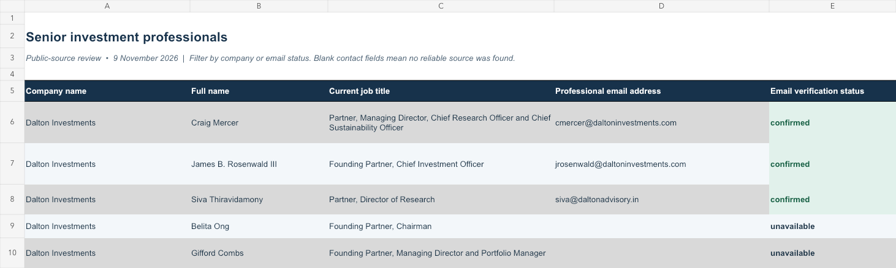

# Investment contact research demo

A public-source research example for finding senior investment decision-makers, checking their current roles, and recording professional contact details without guessing missing email addresses.

The example covers seven firms:

- Dalton Investments
- Elliott Investment Management
- ValueAct Capital
- Oasis Management
- Palliser Capital
- Asset Value Investors (AVI)
- 3D Investment Partners

## Results

| Measure | Count |
| --- | ---: |
| Senior professionals listed | 43 |
| Work emails explicitly published for the named person | 17 |
| Matched personal LinkedIn profiles | 26 |
| Firms covered | 7 |



The files are available as [Excel](data/investment-professional-contacts.xlsx) and [CSV](data/investment-professional-contacts.csv).

## What the status means

`confirmed` means a cited public source explicitly connected the work address to the named person. It does not mean the mailbox was tested or still receives mail.

`unavailable` means the reviewed sources did not provide a reliable individual address. Shared legal, media, recruiting and investor-relations inboxes were excluded. No address was generated from a naming pattern.

Some email sources are historical filings. Each row records the email source and a note explaining its date or limitation. Current role evidence is stored separately from email evidence.

## Method

1. Start with the firm's official team page or a current regulator filing.
2. Keep only senior investment decision-makers.
3. Exclude investor relations, legal, compliance, operations, HR and administrative staff.
4. Confirm each person's current title with a named source.
5. Search public company filings, shareholder agreements, campaign letters and firm documents for a directly attributed work address.
6. Keep the email blank when the evidence supports only a shared inbox or a guessed format.
7. Record a personal LinkedIn URL only when the identity matches the employer, role or another reliable source.
8. Export the results with role source, email source, profile evidence and limitations.

See [the full methodology](docs/METHODOLOGY.md) and run:

```bash
python3 validate_dataset.py
```

The validation script checks the published CSV's schema, allowed statuses, URL structure, duplicate people, and the rule that every listed email has its own evidence URL.

## Limits

- Review date: 9 November 2026.
- This is a public-source sample, not a complete employee directory.
- Mailbox delivery was not tested.
- LinkedIn restricted direct access to some pages; retained profiles were matched through indexed public profile text and corroborating sources.
- Roles, profiles and addresses may change after the review date.

## Data notice

The spreadsheet contains professional contact details already published in the cited sources. Use them responsibly and follow applicable platform terms, privacy rules and outreach laws. Source documents retain their own terms. The MIT license applies to the repository's original code and documentation, not to third-party source material.

